 🍲 Dibuang Sayang


> **Platform Penyelamat Makanan Berlebih (Surplus Food) untuk Mengurangi Food Waste dan Menyediakan Pilihan Makanan Terjangkau.**


---


## 📌 Daftar Isi
- [Latar Belakang](#-latar-belakang)
- [Problem Statement](#-problem-statement)
- [Solusi](#-solusi)
- [Fitur Utama (MVP)](#-fitur-utama-mvp)
- [Arsitektur & Modul Sistem](#-arsitektur--modul-sistem)
- [Integrasi Data & API Publik](#-integrasi-data--api-publik)
- [Tech Stack](#-tech-stack-rekomendasi)
- [Struktur Direktori](#-struktur-direktori)
- [Panduan Memulai (Quick Start)](#-panduan-memulai-quick-start)
- [Alur Pengguna (User Flow)](#-alur-pengguna-user-flow)
- [Roadmap Pengembangan](#-roadmap-pengembangan)
- [Screenshot](#screenshot)
- [AI Disclosure](#ai-disclosure)
- [Lisensi](#-lisensi)


---


## 📖 Latar Belakang


Banyak restoran, *bakery*, kafe, dan toko makanan memiliki stok makanan berlebih yang masih sangat layak dan aman dikonsumsi, namun tidak terjual pada penghujung hari operasional. Makanan-makanan ini sering kali berakhir menjadi limbah organik (*food waste*).


Di sisi lain, terdapat masyarakat, mahasiswa, maupun pekerja yang ingin mendapatkan makanan berkualitas dengan harga yang jauh lebih hemat dan terjangkau. **Dibuang Sayang** hadir sebagai jembatan digital antara mitra penyedia makanan dan konsumen untuk memitigasi pemborosan makanan sekaligus menciptakan dampak ekonomi dan lingkungan yang positif.


---


## 🎯 Problem Statement


> **Bagaimana menyediakan platform yang memudahkan pengguna menemukan makanan berlebih dari restoran di sekitar mereka dengan harga yang lebih murah, sekaligus membantu restoran mengurangi *food waste*?**


---


## 💡 Solusi


Membangun aplikasi web interaktif yang memungkinkan gerai makanan menawarkan surplus makanan harian dalam bentuk **Surprise Box** atau paket makanan hemat berdiskon. Pengguna dapat:
- Menjelajahi restoran terdekat berbasis peta interaktif (*geolocation*).
- Memilih paket makanan sebelum batas waktu operasional berakhir.
- Melakukan reservasi pemesanan secara daring (*online order*).
- Mengambil langsung pesanan di restoran (*in-store self-pickup*) dalam 24 jam sejak pesanan dibuat dan sebelum kedaluwarsa.


---


## 🚀 Fitur Utama (MVP)


| Fitur | Deskripsi |
| :--- | :--- |
| **1. Browse Food** | Pengguna dapat melihat katalog makanan/surprise box yang tersedia dari berbagai mitra, lengkap dengan foto, nama paket, potongan harga (diskon), sisa stok, dan jam operasional. |
| **2. Location & Map** | Visualisasi sebaran mitra restoran di sekitar lokasi pengguna melalui peta interaktif berbasis koordinat lintang & bujur (Latitude/Longitude). |
| **3. Pick Up / Order** | Alur reservasi paket makanan untuk diambil langsung di gerai (*self-pickup*). Dilengkapi dengan ringkasan instruksi penjemputan, masa berlaku pesanan 24 jam, serta detail alamat gerai. |
| **4. Review / Rating** | Pengguna dapat memberikan ulasan (teks) dan rating (bintang 1-5) setelah mendapatkan makanan yang dipesan. Rating dan Review ditampilkan di halaman restoran. |


## 🌐 Integrasi Data & API Publik


- **OpenStreetMap (OSM) via Leaflet.js**
  - **Fungsi:** Menyediakan peta dasar (*base map tile*) gratis, ringan, dan *open-source* untuk menampilkan posisi restoran dan pengguna.
  - **Implementasi:** Library `leaflet` digunakan untuk merender peta interaktif, kustomisasi pin/marker, dan *event listener* klik pada marker.
- **Dummy Restaurant Data (`data/restaurants.json`)**
  - **Fungsi:** Kumpulan dataset simulasi restoran mitra untuk mendukung fitur *Browse*, *Map*, dan *Order*.
- **Google Authentication (Google Identity Services)**
  - **Fungsi:** Menyediakan fitur autentikasi pengguna melalui akun Google sehingga pengguna dapat melakukan login tanpa perlu membuat password secara manual.
- **Browser Geolocation API**
  - **Fungsi:** Mendapatkan koordinat lokasi pengguna berdasarkan izin yang diberikan melalui browser.
---
## 🧩 Modul Aplikasi


Aplikasi terbagi menjadi 4 modul:


| Modul | Tanggung Jawab & Fungsi Utama | PIC
| :--- | :--- | :--- |
| **🍔 Food & Restaurant** | Mengelola dan menampilkan data restoran serta *surprise box* yang tersedia, seperti nama restoran, jenis makanan, harga normal & diskon, sisa stok, serta jam ketersediaan/waktu *pickup*. | Kapitra Fachriza Utomo 2506623231
| **🗺️ Location & Map** | Menampilkan lokasi restoran pada peta interaktif menggunakan **OpenStreetMap** dan **Leaflet.js**. Pengguna dapat melihat penanda (*marker*) restoran dan mengakses detail ringkasan informasi lokasinya. | Muhammad Akbar Rinaldy 2506586311
| **🛍️ Pick up / Order** | Memfasilitasi alur transaksi pemesanan: memungkinkan pengguna memilih *surprise box*, melakukan reservasi penjemputan (*pickup*), serta menyajikan voucher berisi kode pickup, masa berlaku 24 jam, dan alamat pengambilan. | Dyah Zhafira Wibowo 2506623723
| **⭐ Review / Rating** | Mengelola pemberian rating (bintang 1-5) dan ulasan teks dari pengguna setelah menerima makanan, menampilkan rating rata-rata dan kumpulan ulasan pada halaman restoran sebagai bahan pertimbangan pengguna lain. | Khansa Nathania Khairunnisa 2506618061

---

## 🛠 Panduan Memulai (Quick Start)

1. Clone repo dan masuk ke direktori project.
2. Buat virtual environment:
   ```bash
   python -m venv .venv
   # Windows
   .venv\Scripts\activate
   # macOS/Linux
   source .venv/bin/activate
   ```
3. Install dependency untuk development dan testing:
   ```bash
   pip install -r requirements-dev.txt
   ```

   Build production PWS memakai `requirements.txt`. Selenium hanya diperlukan untuk
   tes browser dan dipasang melalui `requirements-dev.txt`.
4. Salin `.env.example` menjadi `.env`, isi `SECRET_KEY` dengan nilai acak.
5. Jalankan migrasi:
   ```bash
   python manage.py migrate
   ```
6. Isi data awal (restoran dan surprise box):
   ```bash
   python manage.py seed_food
   ```
7. (Opsional) Buat superuser untuk akses admin:
   ```bash
   python manage.py createsuperuser
   ```
8. Jalankan server development:
   ```bash
   python manage.py runserver
   ```
9. Buka `http://127.0.0.1:8000/`.

Settings default (`manage.py`) memakai `config.settings.dev` (SQLite lokal). Untuk test, jalankan
dengan `DJANGO_SETTINGS_MODULE=config.settings.test`. Untuk produksi (PWS), gunakan
`config.settings.prod` dengan environment variable database yang sesuai (lihat `.env.example`).

## 📁 Struktur Proyek

```
config/            # project settings (base, dev, prod, test), urls
accounts/          # app autentikasi (login, Google OAuth, rate limit) & role pengguna (pembeli/mitra)
food/              # modul Food & Restaurant (Kapitra)
map/               # modul Location & Map (Akbar)
order/             # modul Pick up / Order (Dyah)
review/            # modul Review / Rating (Khansa)
templates/         # base.html + template global
static/css/        # design tokens (tokens.css) & style dasar (base.css)
docs/ERD.md        # kontrak data & ERD antarmodul (dikunci)
fixtures/          # dummy data (50+ restoran & surprise box) untuk mock API
```

## Screenshot

### Umum

| Landing page | Peta restoran |
| :--- | :--- |
| 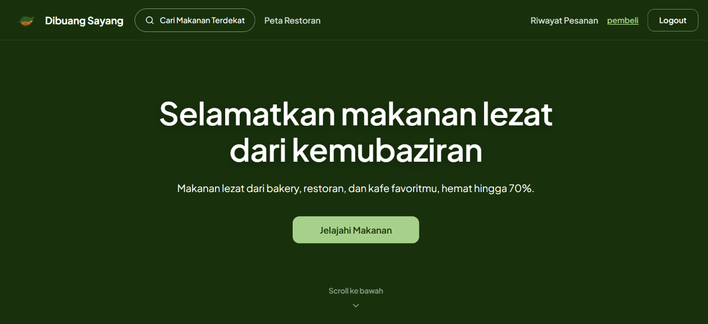 | 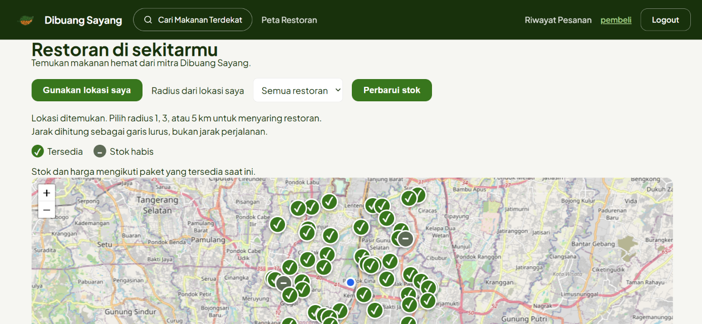 |

| Login | Register |
| :--- | :--- |
| 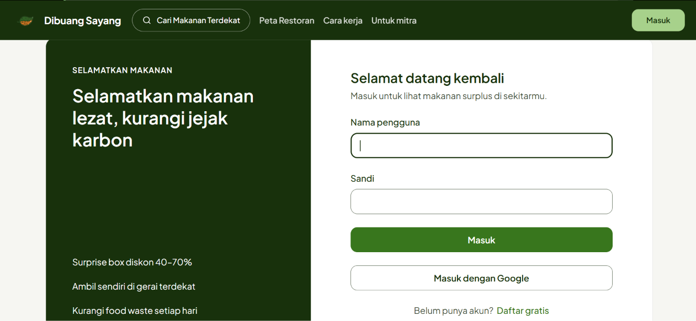 | 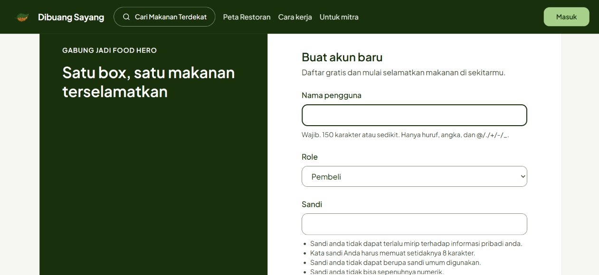 |

### Alur pembeli

| Katalog | Detail restoran |
| :--- | :--- |
| 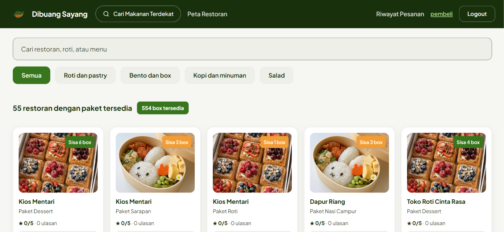 | 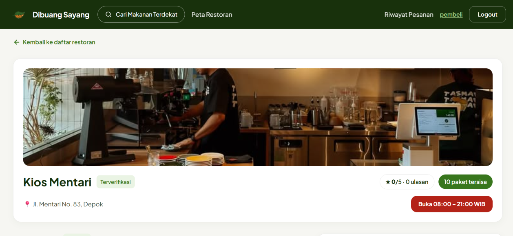 |

| Pilih paket dan jumlah | Checkout |
| :--- | :--- |
| 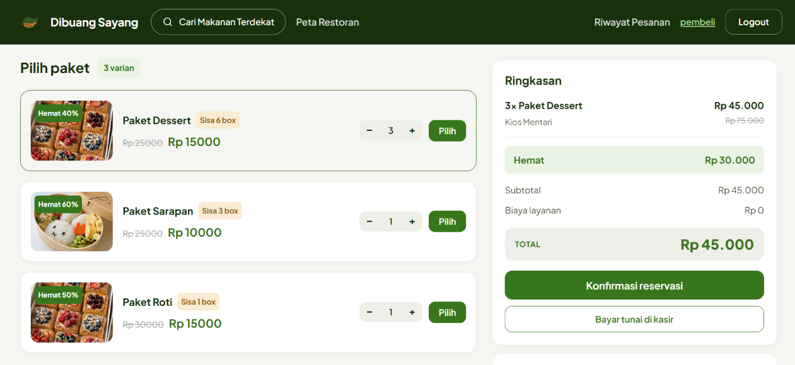 | 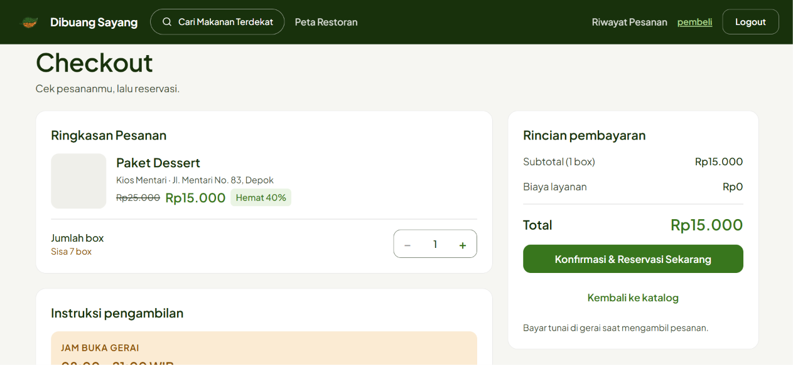 |

| Voucher reservasi | Riwayat pesanan |
| :--- | :--- |
| 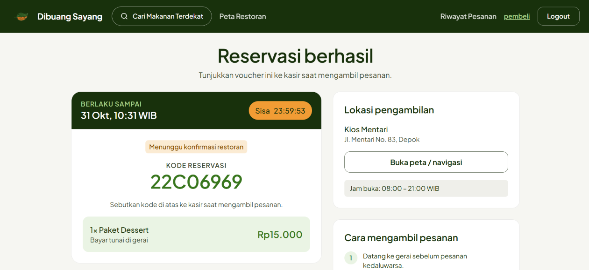 | 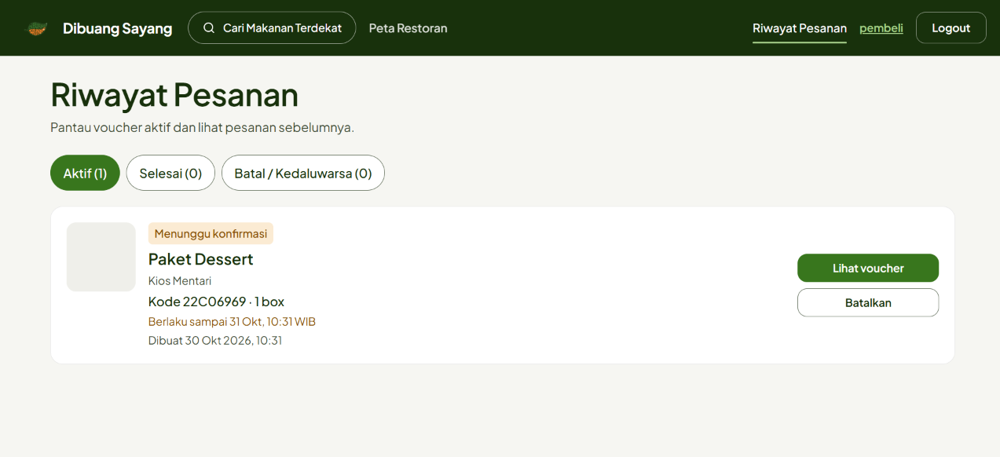 |

### Alur mitra restoran

| Profil mitra | Restoran saya |
| :--- | :--- |
| 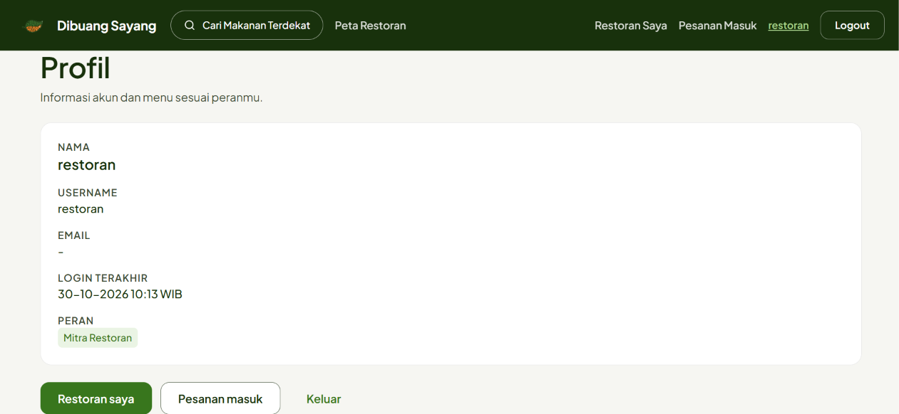 | 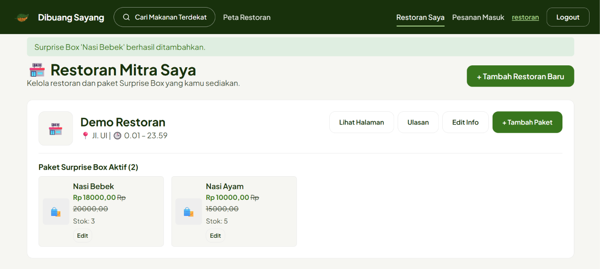 |

| Pesanan masuk | |
| :--- | :--- |
| 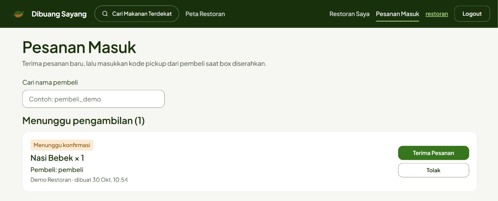 | |

### Review dan rating

| Beri ulasan | Ulasan pelanggan (mitra) |
| :--- | :--- |
| 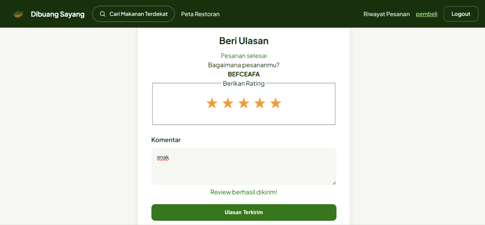 | 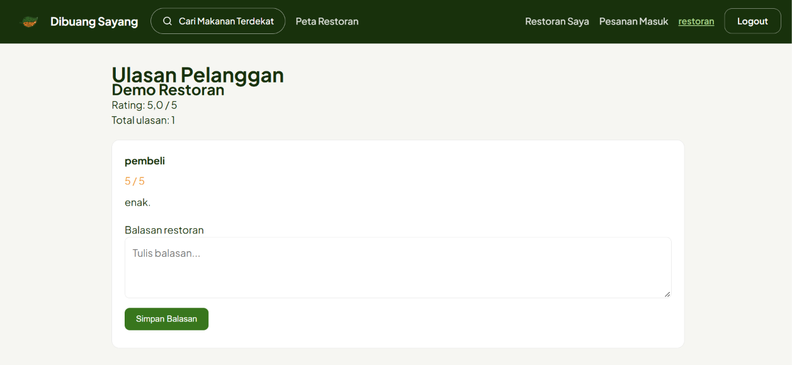 |

| Balasan restoran | Ulasan di detail restoran |
| :--- | :--- |
| 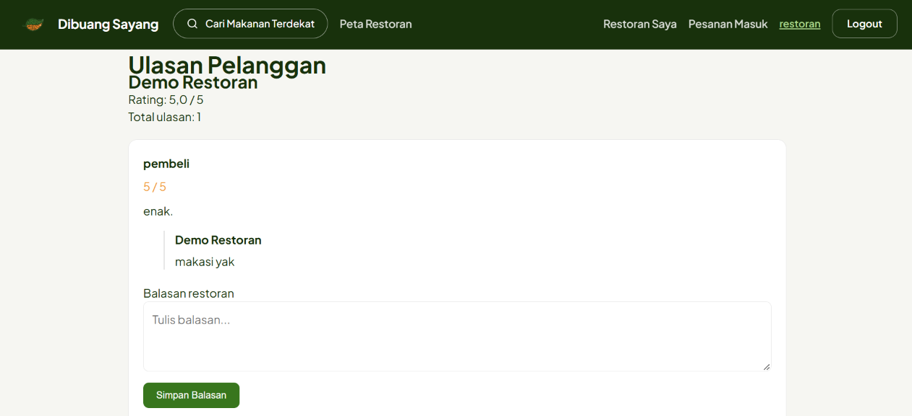 | 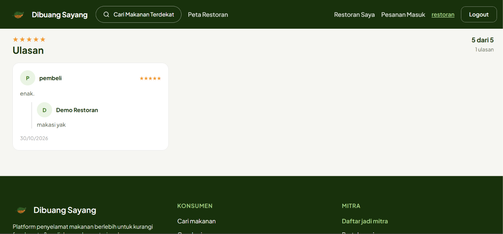 |

## AI Disclosure

### Khansa Nathania K — Fitur Rating & Review

**AI Tools:** ChatGPT (OpenAI)

**Tujuan Penggunaan:**

ChatGPT digunakan sebagai alat bantu pembelajaran dan pendukung pengembangan fitur Rating & Review pada aplikasi Dibuang Sayang.

**Bentuk Penggunaan AI:**

- Membantu memahami konsep Django, seperti model, views, URL routing, ORM, dan relasi antarmodel.
- Membantu memberikan saran implementasi fitur pembuatan, pengeditan, penghapusan (*soft delete*), dan balasan review oleh restoran.
- Membantu memahami validasi hak akses, penanganan review duplikat, dan potensi *race condition*.
- Membantu proses debugging dan perbaikan error pada backend serta pengujian otomatis GitHub Actions.
- Membantu memahami pengujian menggunakan Django Test Framework dan Selenium.
- Membantu penyesuaian tampilan frontend, termasuk avatar restoran dan konsistensi tipografi pada balasan review.

**Strategi Penggunaan dan Validasi:**

AI digunakan melalui diskusi interaktif untuk memperoleh penjelasan konsep, contoh kode, serta alternatif penyelesaian masalah. Saran yang diberikan ditinjau dan disesuaikan dengan struktur proyek, kemudian diperiksa melalui pengujian lokal dan GitHub Actions.

**Keterbatasan dan Perbaikan Manual:**
Saran AI tidak selalu langsung sesuai dengan struktur kode dan lingkungan pengembangan. Oleh karena itu, dilakukan penyesuaian manual, termasuk perbaikan respons `JsonResponse`, penyesuaian pengujian Selenium Safari pada lingkungan Linux, serta pemeriksaan kembali sintaks JavaScript dan integrasi frontend.

**Dokumentasi Percakapan AI:**

[Riwayat Penggunaan ChatGPT — Pengembangan Rating & Review](https://chatgpt.com/share/6ae36b96-5f80-83ec-94c6-63fcfe3175a1)

### Modul Pick up Order (Dyah Zhafira)

**Tools:** Claude 
Notes: Mohon maaf log sebelum UTS tidak sengaja terhapus. Berikut log yang masih ada:
https://claude.ai/share/845d8048-0e0e-46bc-b680-8d242dda7a6c

**Tujuan:** membantu planning, implement, testing, audit, dan docs untuk modul Accounts dan Pick up/Order. 

#### Rangkuman AI

| # | Bantuan AI | Kekurangan AI |
| :-- | :--- | :--- |
| 1 | Bantu implementasi test race condition stok (OrderStockRaceConditionTest) | Aman di Postgres, tapi local pakai SQLite, sehingga perlu penyesuaian manual |
| 2 | Bantu implementasi 3 test Selenium | - |
| 3 | Membantu decide alur `pending -> confirmed -> completed`, sistem kode pickup, cancel dari `pending`, dan form `OrderCreateForm` & `PickupCodeForm`. | Pesanan `confirmed` yang kedaluwarsa awalnya ga return stok. Selain itu, di interface restoran sempat muncul atau leak kode pickupnya, sehingga dihapus bagian tersebut |
| 4 | Bantu implementasi login Google dengan Authlib user baru jadi `buyer` dengan `google_<sub>`dan email bentrok ditolak| - |
| 5 | Rate limiter di cache Django (`accounts/ratelimit.py`) dan test-nya. | - |

List tersebut di ambil dari log yang masih ada. Untuk log yang terhapus, AI tersebut membantu implementasi template HTML dan ajax sesuai desain (termasuk dari sisi user interface dan design system). Selain itu, AI membantu untuk memvalidasi model, form, dan view yang ada. Ada beberapa bagian AI yang membantu saat refactor juga.

#### Verifikasi hasil AI
- Run test otomatis (unit dan Selenium) setelah perubahan.
- Mengukur coverage modul accounts dan order.
- Tes edge case dan keamanan langsung lewat test client dan di lokal sebagai pembeli dan mitra.
- Cek diff sebelum commit.

#### Keterbatasan yang masih ada
- Jam buka dan tutup restoran belum digunakan untuk membatasi pesanan. Karena jadwal pickup dan expired 24 jam, sehingga jam buka dan tutup restoran hanya sebagai informasi tambahan bagi pembeli terkait waktu pickup.
- Pengguna yang masuk lewat Google secara default dan otomatis menjadi pembeli, sehingga restoran harus membuat akun sendiri, tidak bisa lewat Google.