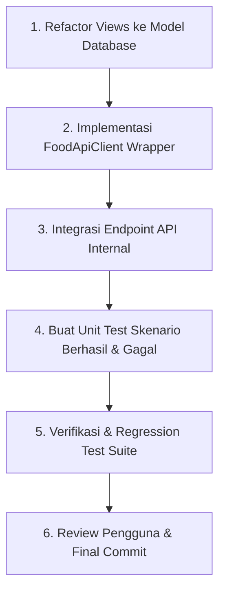

# 📋 Rencana Aksi: Penyelesaian TODO-List Modul Food & Restaurant

**Penanggung Jawab (PIC)**: Kapitra Fachriza Utomo  
**Modul**: `food` (Food & Restaurant) — *Dibuang Sayang*  
**Status**: Selesai (100% Terverifikasi, Tests Passed)  

---

## 🎯 Ringkasan Kebutuhan
Berdasarkan daftar TODO-list yang belum terselesaikan pada modul Food:
1. **Verifikasi API client wrapper sesuai timeout, cache, dan fallback (di PRD)**.
2. **Memastikan data Food murni bersumber dari model database (`SurpriseBox` / `Restaurant`), bukan dari file JSON**.
3. **Menguji skenario API berhasil & gagal melalui unit testing**.

---

## 🏗️ Alur Eksekusi



---

## 📝 Rencana Kerja Terperinci

### 🔹 Langkah 1: Migrasi Penuh ke Model Database (ORM)
* **File Target**: `food/views.py`
* **Permasalahan Saat Ini**:
  * Terdapat fungsi `_load_dummy_data()` yang membaca langsung file `fixtures/dummy_data.json` sebagai fallback runtime jika database kosong.
* **Tindakan**:
  1. Hapus pemanggilan `_load_dummy_data()` dari view `food_list`, `restaurant_detail`, `api_restaurants`, dan `api_surprise_boxes`.
  2. Pastikan query data 100% menggunakan Django ORM:
     * `Restaurant.objects.filter(is_active=True)`
     * `SurpriseBox.objects.filter(is_active=True, restaurant__is_active=True)`
  3. Jika database kosong, tampilkan *empty state* yang rapi di template (bukan fallback membaca file JSON secara diam-diam).
  4. Penyediaan data awal tetap menggunakan seeder resmi:
     ```powershell
     python manage.py seed_food
     ```

---

### 🔹 Langkah 2: Implementasi `FoodApiClient` Wrapper
* **File Target**: `food/api_client.py`
* **Tujuan**: Mengabstraksi pemanggilan data/API dengan mekanisme ketahanan jaringan (*resilience*) sesuai PRD.
* **Spesifikasi Teknis**:
  1. **Konfigurasi Timeout**:
     * Menetapkan batas waktu maksimum eksekusi request (default: `5.0 detik`).
     * Mencegah thread server menggantung (*hanging*) saat terjadi latensi tinggi.
  2. **Mekanisme Caching (Django Cache Framework)**:
     * Menggunakan `django.core.cache.cache` untuk menyimpan data query yang sering diakses.
     * Mengatur cache key terstruktur (misal: `food:restaurants:list`, `food:restaurant:<id>`).
     * Menentukan TTL (*Time-To-Live*) default 300 detik (5 menit).
  3. **Mekanisme Fallback yang Tangguh**:
     * Menangkap error jaringan, timeout, atau error query database.
     * Mengembalikan data cadangan (*stale cache* bila tersedia, atau data terstruktur yang aman/kosong) tanpa menyebabkan status HTTP 500 (*Internal Server Error*).

---

### 🔹 Langkah 3: Integrasikan Wrapper ke Endpoint API Food
* **File Target**: `food/views.py` dan `food/urls.py`
* **Tindakan**:
  * Hubungkan `api_restaurants` dan `api_surprise_boxes` ke `FoodApiClient`.
  * Memastikan modul konsumen lain (seperti modul `map` / Leaflet) menerima respon JSON yang konsisten, cepat (karena cache), dan aman dari downtime.

---

### 🔹 Langkah 4: Penulisan Unit Test Skenario Berhasil & Gagal
* **File Target**: `food/tests.py`
* **Daftar Test Case**:
  1. **Skenario Berhasil (*Success Scenarios*)**:
     * `test_api_client_fetch_restaurants_success`: Memastikan data berhasil diambil dari model database dengan format JSON yang valid.
     * `test_api_client_caching_behavior`: Memastikan pemanggilan data kedua membaca dari cache (*cache hit*).
     * `test_api_surprise_boxes_success`: Memastikan endpoint list box aktif mengembalikan status 200 OK dan skema atribut yang benar.
  2. **Skenario Gagal (*Failure / Edge Scenarios*)**:
     * `test_api_timeout_triggers_fallback`: Mensimulasikan timeout pada pemanggilan data dan memverifikasi bahwa data fallback terkirim dengan aman.
     * `test_api_network_error_handled`: Mensimulasikan network/database error dan memastikan tidak ada unhandled 500 error.
     * `test_restaurant_not_found`: Memastikan pencarian ID restoran yang tidak ada mengembalikan 404 secara tepat.
     * `test_pure_database_empty_state`: Memastikan jika database kosong, view mengembalikan empty state dan tidak crash atau membaca file JSON secara ilegal.

---

### 🔹 Langkah 5: Verifikasi & Uji Regresi
1. Jalankan unit test modul `food`:
   ```powershell
   python manage.py test food
   ```
2. Jalankan seluruh test suite aplikasi untuk memastikan pengujian tetap 100% OK tanpa regresi:
   ```powershell
   python manage.py test
   ```
3. Lakukan pengujian manual melalui server lokal di browser (`http://127.0.0.1:8000/food/`).

---

## ✅ Kriteria Keberhasilan (Acceptance Criteria)
- [x] View pada modul `food` tidak lagi memuat data dari `fixtures/dummy_data.json` secara langsung saat runtime.
- [x] Modul `FoodApiClient` terpasang dengan konfigurasi timeout, caching Django, dan fallback teruji.
- [x] Seluruh skenario pengujian berhasil dan gagal di `food/tests.py` berstatus **PASS**.
- [x] Seluruh unit test proyek tetap **100% PASS**.
