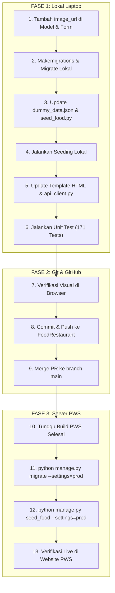

# 📖 Panduan Lengkap: Implementasi Foto Restoran & Menu (Lokal hingga PWS)

Dokumen ini memuat panduan komprehensif langkah demi langkah untuk mengintegrasikan foto restoran dan paket *Surprise Box* pada modul **Food & Restaurant** aplikasi *Dibuang Sayang*, mulai dari pengembangan lokal, *commit & push*, hingga *seeding* di *Pacil Web Service* (PWS).

---

## 🏗️ Alur Eksekusi (Overview)



---

## 💻 FASE 1: Pengerjaan di Laptop (Lokal)

### Langkah 1: Tambah Field `image_url` pada Model & Form
1. Buka `food/models.py`:
   * Pada model `Restaurant`:
     ```python
     image_url = models.URLField(max_length=1000, blank=True, null=True, help_text="Tautan foto restoran")
     ```
   * Pada model `SurpriseBox`:
     ```python
     image_url = models.URLField(max_length=1000, blank=True, null=True, help_text="Tautan foto produk makanan")
     ```
2. Buka `food/forms.py`:
   * Tambahkan `"image_url"` pada list `fields` di `RestaurantForm` dan `SurpriseBoxForm`.

---

### Langkah 2: Buat & Terapkan Migrasi Database Lokal
Jalankan di terminal:
```powershell
python manage.py makemigrations food
python manage.py migrate
```

---

### Langkah 3: Kurasi Link Foto HD & Perbarui File Seeder
1. Siapkan link foto Pinterest CDN direct HTTPS yang stabil, beresolusi optimal, dan cepat:
   * **Roti & Pastry**: Croissant, sourdough, bakery display.
   * **Bento & Makanan Berat**: Bento box, rice bowl, ayam katsu.
   * **Kopi & Minuman**: Iced latte, espresso, cafe cup.
   * **Salad & Healthy**: Fresh salad bowl, veggie wrap.
   * **Default Box**: Eco-friendly craft paper bag.
   * **Banner Restoran**: Toko roti hangat, kafe modern, bistro, kedai siap saji.
2. Perbarui `fixtures/dummy_data.json`:
   * Tambahkan key `"image_url"` untuk setiap entri restoran (55 gerai) dan surprise box (104 paket).
3. Perbarui `food/management/commands/seed_food.py`:
   * Pastikan `Restaurant.objects.update_or_create` dan `SurpriseBox.objects.update_or_create` membaca `item.get("image_url", "")`.

---

### Langkah 4: Jalankan Seeding di Laptop
Jalankan di terminal:
```powershell
python manage.py seed_food
```
Seluruh 55 restoran dan 104 surprise box di database lokal sekarang telah memiliki foto.

---

### Langkah 5: Perbarui Tampilan Template HTML & API Client

#### A. Pada `food/templates/food/food_list.html`
* Tambahkan styling CSS:
  ```css
  .resto-card__img {
    width: 100%;
    height: 100%;
    object-fit: cover;
    position: absolute;
    top: 0;
    left: 0;
    border-radius: 12px;
    transition: transform 0.3s ease;
    z-index: 1;
  }
  .resto-card:hover .resto-card__img {
    transform: scale(1.05);
  }
  .badge-dist, .badge-card-stock {
    z-index: 2;
  }
  .resto-card__placeholder {
    display: flex;
    flex-direction: column;
    align-items: center;
    justify-content: center;
    gap: 4px;
    width: 100%;
    height: 100%;
    z-index: 1;
  }
  ```
* Tambahkan tag gambar dengan *fallback error handler* (`onerror`):
  ```html
  
    
  
  <div class="resto-card__placeholder" style="display: none;display: flex;">
    <span style="font-size: 28px;">🛍️</span>
    <span>Foto produk</span>
  </div>
  ```

#### B. Pada `food/templates/food/restaurant_detail.html`
* Tampilkan banner hero restoran dengan `restaurant.image_url` beserta fallback placeholder.
* Tampilkan foto menu makanan di `.box-menu-thumb`.

#### C. Pada `food/api_client.py`
* Sertakan key `"image_url"` pada hasil serialisasi dictionary restoran dan paket box.

---

### Langkah 6: Jalankan Validasi Test Suite
```powershell
python manage.py test food
python manage.py test
```

---

## 🚀 FASE 2: Review, Commit, & Push ke GitHub

### Langkah 7: Pengujian Visual di Browser Lokal
Jalankan server lokal:
```powershell
python manage.py runserver
```
Buka browser dan periksa:
* `http://127.0.0.1:8000/food/`
* `http://127.0.0.1:8000/food/1/`

### Langkah 8: Commit & Push ke Branch `FoodRestaurant`
```powershell
git add food/ fixtures/dummy_data.json
git commit -m "feat(food): add image_url to Restaurant and SurpriseBox with photo seeding and UI integration"
git push origin FoodRestaurant
```

### Langkah 9: Merge Pull Request ke `main` di GitHub
1. Buat dan merge Pull Request dari branch `FoodRestaurant` ke `main`.
2. Tunggu proses deployment PWS berjalan.

---

## 🌐 FASE 3: Penerapan & Seeding di Server PWS

### Aturan Emas PWS:
> Server live menggunakan PostgreSQL (`config.settings.prod`). Setiap eksekusi perintah database di PWS Terminal wajib menyertakan flag `--settings=config.settings.prod`!

### Langkah 10: Eksekusi Migrasi di PWS Terminal
```bash
python manage.py migrate --settings=config.settings.prod
```

### Langkah 11: Eksekusi Seeding Data Foto di PWS
```bash
python manage.py seed_food --settings=config.settings.prod
```
Output konfirmasi:
```text
Loaded 55 restaurants.
Loaded 104 surprise boxes successfully.
```

### Langkah 12: Verifikasi Live Website
Buka website PWS di browser dan lakukan hard refresh (`Ctrl + F5`). Seluruh restoran dan menu Surprise Box kini tampil hidup dengan foto HD asli.
